<div align="center">


# Devleck Lead Engine

**AI-powered B2B prospecting and sales pipeline for the US market — from calibrated niche research to closed deals.**

Claude Code researches the web, verifies contact data, qualifies each business against a service catalog
and writes the call script and emails. A local dashboard turns the result into a call queue, a color-coded pipeline
and a follow-up agenda, so reps spend their day selling instead of researching.

[](CHANGELOG.md)
[](https://nodejs.org)
[](https://claude.com/claude-code)
[](package.json)
[](tests/)
[](#quick-start)
[](LICENSE)

[Overview](#overview) · [Product tour](#product-tour) · [Sales pipeline model](#the-sales-pipeline-model) · [Niche potential](#calibrated-niche-potential) · [Catalog](#service-catalog) · [Architecture](#architecture) · [Quick start](#quick-start) · [Design decisions](#design-decisions)

<br/>

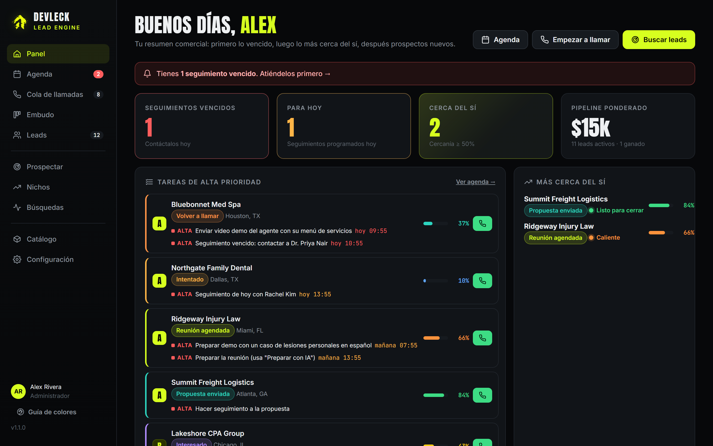

</div>

---

> [!NOTE]
> **New in v1.1:** pipeline stages and a drag-and-drop kanban, *closeness to a yes*, prioritized tasks, an agenda with reminders,
> notes visible everywhere, manual contact enrichment, a semantic color system, niche potential calibrated with cited market data,
> a Spanish sales guide for every service and a new AI training service. See the [changelog](CHANGELOG.md).

## Overview

Cold outreach usually fails for two reasons: the list is wrong (businesses that can't or won't buy), and reps waste
their time researching instead of calling. **Devleck Lead Engine** fixes both, then keeps every deal moving until it closes.

You describe **what you sell** in a structured catalog. The engine finds US businesses that show **real, cited evidence**
of needing it: job posts for a front-desk role, reviews complaining about unanswered phones, a website stuck in 2017, a new location.
Each lead comes back with:

| | |
|---|---|
| 📞 **Verified contact data** | Phone numbers and emails, each with the URL where it was found and a confidence level (`verified` · `listed` · `pattern`) |
| 🎯 **What to sell and why** | The best-fit service from the catalog, the evidence behind it, a deal-size estimate and an ROI argument |
| 🗣️ **Ready-to-use outreach** | Call opener, discovery questions, objection handling, voicemail, first email and follow-up, all personalized to the business |
| 📊 **Two clear numbers** | *Lead quality* (is this worth calling?) and *closeness to a yes* (how near is this deal to closing?) |
| ✅ **A next step, always** | Prioritized tasks and dated follow-ups, so no lead is ever forgotten |

The research runs on **each rep's own Claude subscription** through Claude Code's headless mode. There are no API keys,
no per-seat SaaS fees and no hosted backend to maintain.

## Product tour

> All data shown is fictional demo data (`npm run demo`). Businesses, people, `.example` domains and `555-01xx` numbers are invented.
> The interface is in Spanish because the sales team is based in Colombia; outreach copy for prospects is in English.

### 1 · Start the day with the agenda

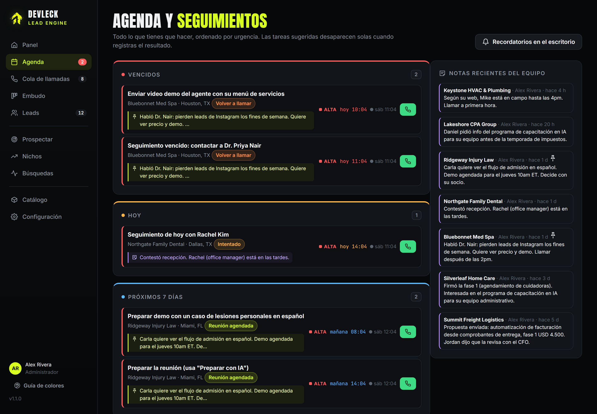

Every follow-up and task is grouped by urgency:    → no date.
*Suggested* tasks are derived from each lead's state and clear themselves once done, while *manual* tasks carry a priority and a due date.
In-app and desktop notifications fire when a follow-up is due, the sidebar shows a red counter, and the right column is a feed of the team's latest notes.

### 2 · Work the call queue

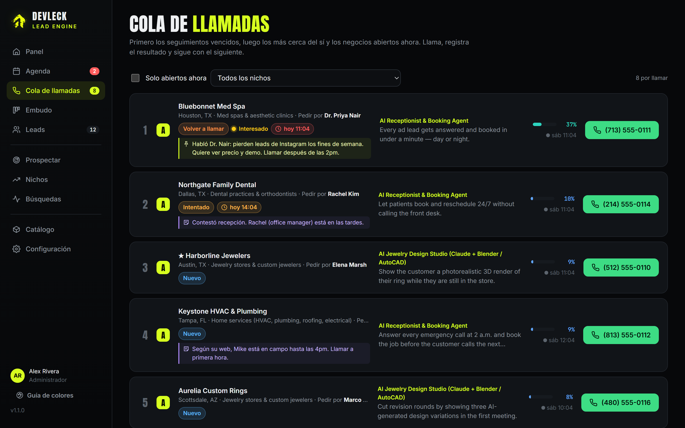

The queue is ranked by **overdue follow-ups → closeness to a yes → lead quality → open right now** in the lead's own timezone.
One click dials (`tel:`), and the lead opens on its call script while the phone rings.

### 3 · Everything about a lead in one place

<table>
  <tr>
    <td width="52%">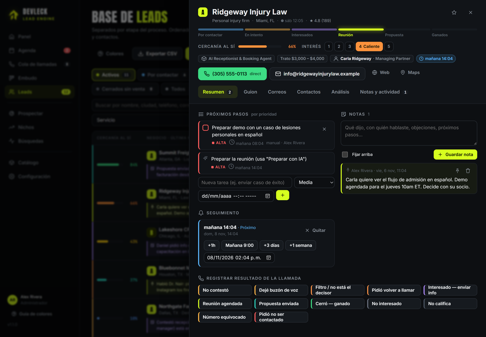</td>
    <td>
      <ul>
        <li><b>Stage stepper</b>: click a stage to move the deal.</li>
        <li><b>Closeness to a yes</b> meter and the rep's <b>interest rating</b> (1 cold → 5 ready to close).</li>
        <li><b>Prioritized next steps</b>, suggested and manual.</li>
        <li><b>Follow-up</b> scheduling in one click (+1 h, tomorrow 9:00, +3 days, +1 week).</li>
        <li><b>Pinned notes</b> that surface in every list and card.</li>
        <li><b>Call outcomes</b> (no answer, voicemail, gatekeeper, meeting, proposal, won…) that update the stage and interest and schedule the next touch.</li>
      </ul>
    </td>
  </tr>
</table>

### 4 · Call script, emails and manual enrichment

<table>
  <tr>
    <td width="50%">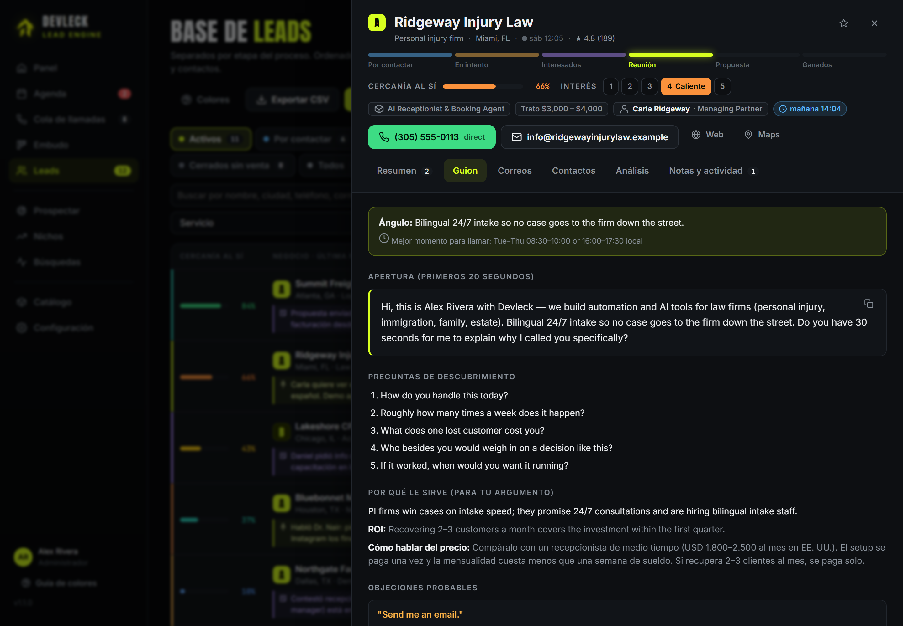</td>
    <td width="50%">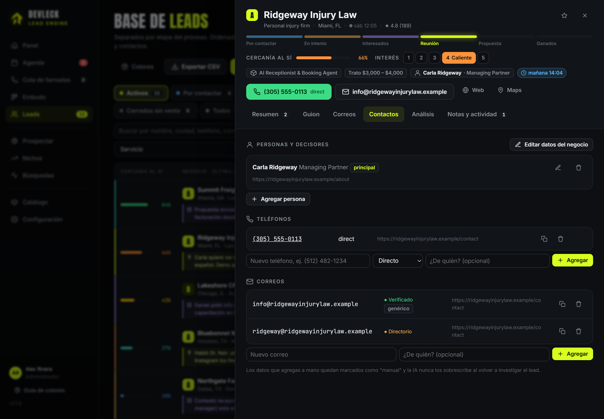</td>
  </tr>
  <tr>
    <td><b>Script</b>: an angle grounded in evidence about this specific business, a 20-second opener, discovery questions, ROI, price talk, objections and a voicemail. The <b>Emails</b> tab opens the rep's mail client with everything prefilled.</td>
    <td><b>Contacts</b>: every phone and email shows its source and confidence. Reps add the people, numbers and emails they learn on calls, or edit business data. Manual fields are flagged and <b>never overwritten</b> by later AI research.</td>
  </tr>
</table>

### 5 · See the whole pipeline

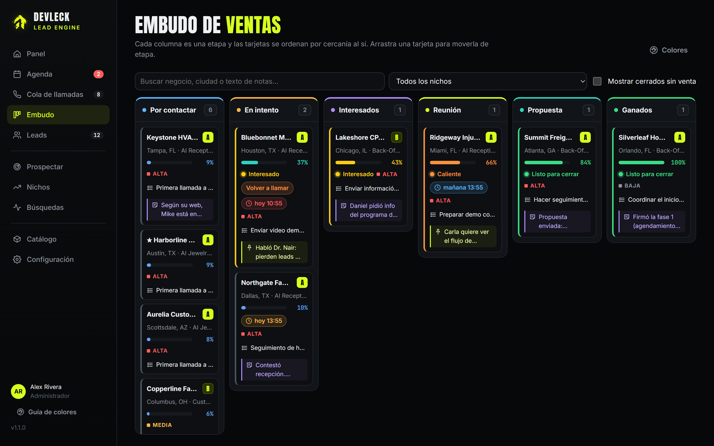

One column per stage. Cards are sorted by closeness to a yes, bordered with their interest color, and show the next task, the follow-up and the last note.
Dragging a card moves the deal, and the interest rating rises to the minimum that makes sense for the new stage.

### 6 · Leads in separate lists by stage

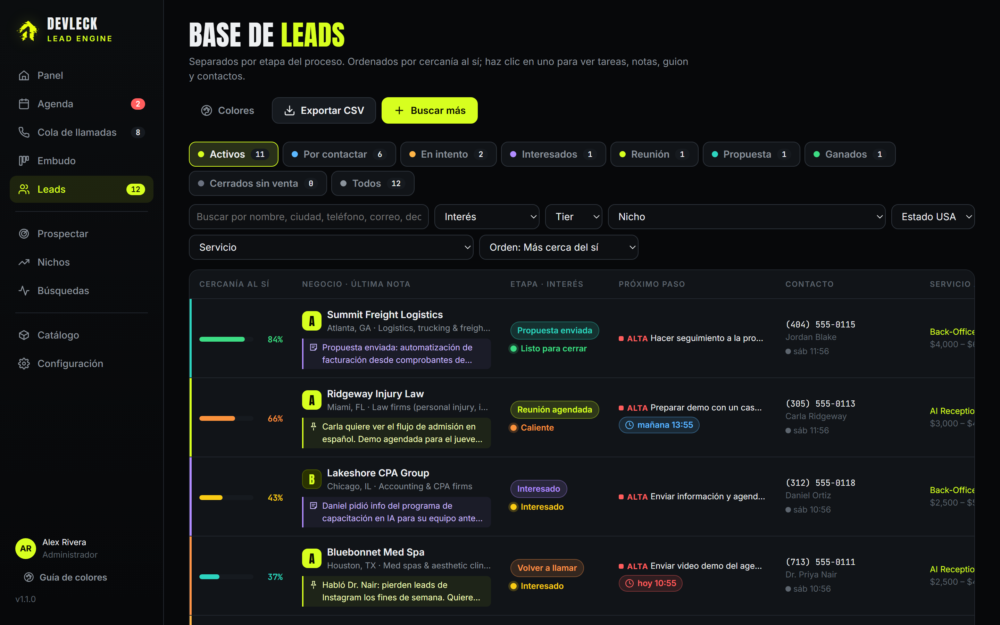

Color-coded tabs split the database into *To contact · Trying · Interested · Meeting · Proposal · Won · Closed*. Each row shows closeness,
stage and interest, the next step and the last note. Search covers names, phones, emails, decision makers **and note text**, and CSV export follows the current view.

### 7 · Prospect with AI and watch it work

<table>
  <tr>
    <td width="50%">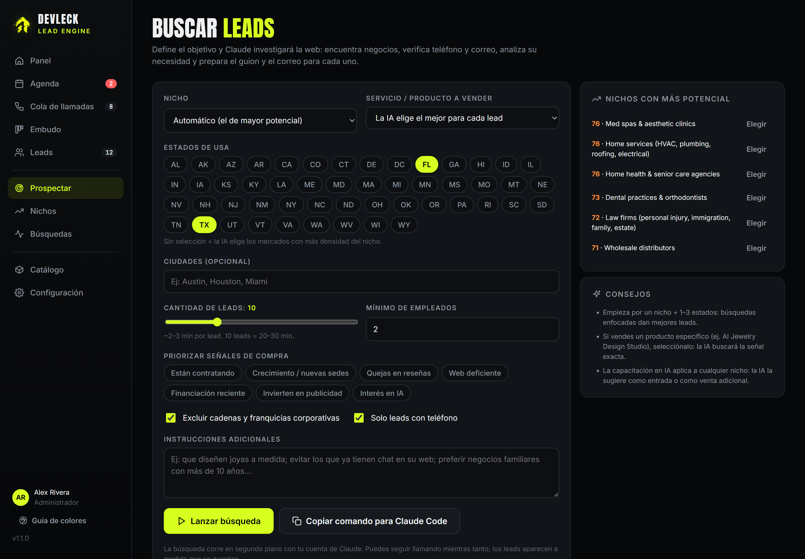</td>
    <td width="50%">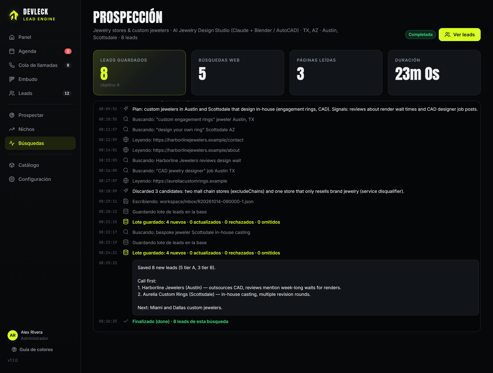</td>
  </tr>
  <tr>
    <td><b>Prospecting</b>: pick a niche (ranked by potential), the product to sell, states, cities and buying signals, then launch.</td>
    <td><b>Live run</b>: every search, page read and saved batch streams from headless Claude Code over Server-Sent Events.</td>
  </tr>
</table>

### 8 · Know where the opportunity is

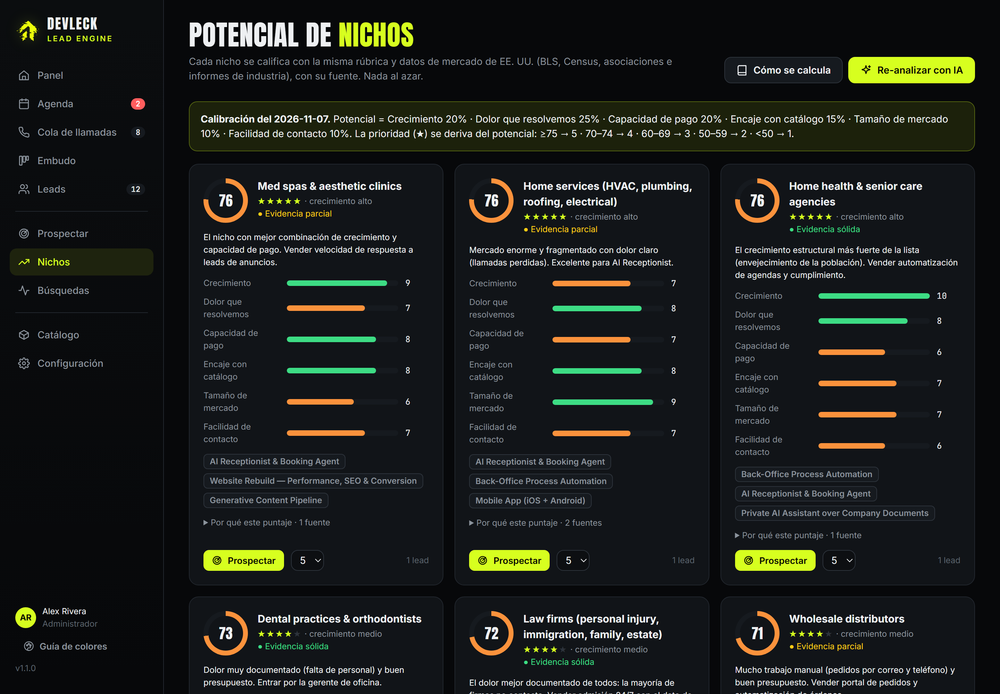

Every niche is scored with the same six-dimension rubric and cited US market data, with the reasoning behind each score.
See [Calibrated niche potential](#calibrated-niche-potential).

### 9 · Learn every service before selling it

<table>
  <tr>
    <td width="50%">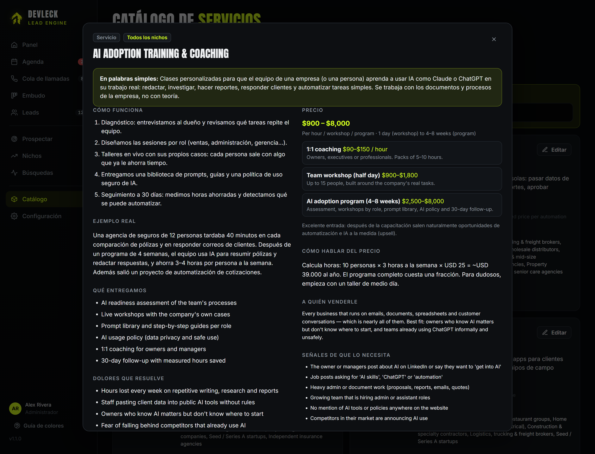</td>
    <td>
      Each catalog item ships with a <b>sales guide in Spanish</b> written for reps, not engineers:
      <ul>
        <li>What it is, in plain words</li>
        <li>How it works, step by step</li>
        <li>A concrete example</li>
        <li>Pricing and packages, plus how to talk about price</li>
        <li>Who to sell to, buying signals and red flags</li>
        <li>Qualifying questions, the pitch and objection handling (in English)</li>
        <li>A glossary of key terms</li>
      </ul>
    </td>
  </tr>
</table>

## The sales pipeline model

### Stages

| Stage | Color | Base probability | Typical outcome that moves a lead here |
|---|---|---:|---|
| New *(to contact)* |  | 5% | Found and qualified by the AI |
| Attempted |  | 8% | No answer · voicemail · wrong number |
| Callback |  | 15% | Gatekeeper · "call me back" |
| Interested |  | 30% | Positive conversation, asked for information |
| Meeting |  | 50% | Meeting booked |
| Proposal |  | 70% | Proposal sent |
| Won |  | 100% | Deal closed |
| Lost · Not a fit · Do not contact |  | 0% | Closed without a sale |

### Two numbers, two questions

- **Lead quality (0–100, tier A/B/C)**: *is this business worth calling?* It is computed once from the research (see [Scoring](#scoring)).
- **Closeness to a yes (0–100%)**: *how close is this deal to closing?* It updates as the rep works the lead:

  ```text
  closeness = 0.6 × stage probability + 0.4 × (interest × 20) + (lead quality − 60) / 8
              − 5 if the follow-up is more than 3 days overdue
              − 5 if an active deal hasn't changed stage in 21 days
  ```

| Interest |  |  |  |  |  |
|---|---|---|---|---|---|
| **Closeness band** | 0–19% | 20–39% | 40–59% | 60–79% | 80–100% |

Interest and closeness share the same cold → hot color scale, so the dashboard reads at a glance.

### Suggested tasks

Tasks are derived from the lead's state and **disappear automatically** once the condition is met. Reps never have to tick off administrative to-dos.

| When | Suggested task | Priority |
|---|---|---|
| Follow-up overdue / due today | Contact the decision maker |  |
| New lead with a phone | First call (high for tier A) |  /  |
| Attempted, email not sent yet | Send the prepared email |  |
| Interested | Send info and book the meeting |  |
| Meeting within 7 days / meeting date passed | Prepare the meeting / log the outcome and send the proposal |  |
| Proposal older than 3 days | Follow up on the proposal |  |
| No decision maker / no verified email | Identify the decision maker / get a verified email |  /  |

## Calibrated niche potential

Niche priorities are not opinions. Each niche is rated 0–10 on six dimensions with a fixed rubric and evidence from public US sources
(BLS Employment Projections, Census, trade associations such as the ADA, AGC, Clio and SEIA, and industry reports). The potential is the weighted sum × 10,
and the 1–5 priority that boosts lead scores is derived from it.

| Dimension | Weight | Question |
|---|---:|---|
| Pain we solve | 25% | Is there evidence of a problem our catalog solves (staff shortages, missed calls, manual work)? |
| Growth | 20% | Is the US market growing? |
| Ability to pay | 20% | Revenue per business, margins, average ticket |
| Catalog fit | 15% | How many services fit, and how directly |
| Market size | 10% | Number of target businesses |
| Reachability | 10% | How easy is it to reach the decision maker by phone? |

<details>
<summary><b>Current ranking (calibrated November 2026)</b></summary>

| Niche | Potential | Why |
|---|---:|---|
| Med spas & aesthetic clinics | **76** | ~10–16% annual market growth, ad-driven booking where every unanswered lead is wasted spend |
| Home services (HVAC, plumbing…) | **76** | ~125k HVAC firms, technician shortage, high-ticket emergency calls |
| Home health & senior care | **76** | BLS projects +18.6% employment growth 2024–34, plus scheduling and compliance paperwork |
| Dental practices | **73** | ADA: over half of practices report staffing shortages |
| Law firms | **72** | Clio 2024: only 40% of firms answered a prospective client's call |
| Wholesale distribution | **71** | Small distributors still take most orders by phone and email |
| Engineering firms | **70** | 11-month median backlog; only 11% of small firms have an AI policy |
| Property management | 68 | ~335k companies; 24/7 maintenance calls |
| … | | 26 niches in total, down to residential solar (**43**) after the 25D tax-credit expiration |

Full scores, notes and sources: [`config/niches.json`](config/niches.json) and the **Nichos** screen. `/nichos` re-runs the research with the same rubric,
and the score is computed from the dimensions rather than taken from the model, so analyses stay comparable over time.
</details>

## Service catalog

Reference pricing for a senior engineering team based in Colombia selling to US businesses. Final prices are quoted per phase after a free scoping call.

| Service / product | Reference price (USD) |
|---|---|
| AI Receptionist & Booking Agent | $1,500 – 4,000 + $150 – 400/mo |
| Back-Office Process Automation | $1,500 – 6,000 per automation |
| **AI Adoption Training & Coaching** *(new, every niche)* | $90 – 150/h · half-day workshop $900 – 1,800 · 4–8 week program $2,500 – 8,000 |
| Website Rebuild — Performance, SEO & Conversion | $1,200 – 4,500 |
| AI Jewelry Design Studio (Claude + Blender / AutoCAD) | $2,500 – 7,500 + $200 – 450/mo |
| Private AI Assistant over Company Documents | $3,500 – 14,000 + $150 – 400/mo |
| Reviews & Customer Sentiment Intelligence | $1,500 – 4,500 + $150 – 350/mo |
| Generative Content Pipeline | $2,000 – 8,000 |
| Retail AI — Demand Forecasting & Dynamic Pricing | $4,500 – 18,000 |
| Custom Web Platform / Customer Portal | $8,000 – 35,000 |
| Mobile App (iOS + Android) | $7,000 – 28,000 |
| Software Rescue & Hardening | Audit $800 – 2,000 · fixes per phase |

## Features

**Prospecting** · targeted searches by niche, product, states, cities, company size and buying signals · free-text niches · chains, duplicates and the blocklist excluded · incremental batch saving.

**Market intelligence** · calibrated, evidence-backed niche potential with a confidence level · `/nichos` re-analysis with the same rubric · suggested new niches.

**Sales pipeline** · lists by stage · drag-and-drop kanban · closeness to a yes · interest rating · suggested and manual tasks · agenda · in-app and desktop reminders · pinned notes surfaced everywhere · team notes feed · semantic color system with a built-in legend.

**Sales workflow** · call queue ranked by urgency and closeness · one-click outcomes · prefilled `tel:` and `mailto:` · on-demand AI call prep · manual enrichment of people, phones, emails and business data · CSV export.

**Administration** · versioned JSON configuration editable from the UI or through Claude · Spanish sales guides · territories · blocklist · in-app updates through git.

## Architecture

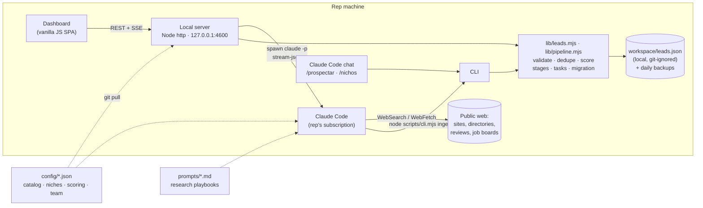

1. **Reasoning: Claude Code.** Markdown playbooks in [`prompts/`](prompts/) define the research method: sources to combine,
   qualification rules, data-integrity rules, outreach guidelines and the exact output contract. The same playbook runs from the
   dashboard (headless `claude -p`) or from an interactive chat (slash commands in [`.claude/commands/`](.claude/commands/)).
2. **Integrity: a deterministic core.** The model never writes the database directly. [`lib/leads.mjs`](lib/leads.mjs) validates, normalizes,
   deduplicates and scores every batch, and rejects bad leads with actionable errors. [`lib/pipeline.mjs`](lib/pipeline.mjs) owns stages, closeness,
   suggested tasks, manual edits and schema migration.
3. **Operations: a local dashboard.** A dependency-free Node server streams the agent's progress over Server-Sent Events and serves a
   single-page app built for one job: getting reps on the phone with the right business at the right time, and making sure every deal has a next step.

## Quick start

**Prerequisites:** [Node.js 18+](https://nodejs.org), [Git](https://git-scm.com) and [Claude Code](https://claude.com/claude-code) signed in to a Claude account.

```bash
git clone https://github.com/Kin9Zeus/Devleck-Lead-Engine.git
cd Devleck-Lead-Engine
npm run check      # verifies Node, Git, Claude Code and the configuration
npm start          # opens http://localhost:4600
```

There is no `npm install` step: the project has zero runtime dependencies. On Windows, double-clicking `iniciar.bat` does the same as `npm start`.

**Just want to look around?** Run `npm run demo`. It opens http://localhost:4601 with fictional sample data stored in `.demo-workspace/`, and it doesn't need Claude Code or a login.

📘 **Team guide:** installation plus an illustrated walkthrough of every screen, in Spanish: [`docs/guia-empleados/Guia-del-Equipo-Devleck-Lead-Engine.pdf`](docs/guia-empleados/Guia-del-Equipo-Devleck-Lead-Engine.pdf) (21 pages).

### Running from the Claude Code chat

```text
/prospectar 10 custom jewelers in Texas and Florida, sell ai-jewelry-design-studio
/nichos which healthcare niches fit the AI Receptionist best right now
/preparar-llamada LMUYO4OR2JDP3
/nuevo-servicio AI tool for jewelers that models rings in 3D with Claude + Blender…
```

Leads created from the chat show up in the dashboard automatically.

## Updating and data safety

Reps update from **Configuración → Buscar actualizaciones → Actualizar ahora**, which runs a fast-forward `git pull`. Their data is protected in four ways:

- **Leads live outside git** in `workspace/`, so an update never touches them.
- **Non-destructive migration**: on startup, leads saved by older versions get the new fields (stage timestamps, interest, tasks, note ids), and nothing is removed. The migration path is covered by tests.
- **Backups**: one copy per day and one before every in-app update, in `workspace/backups/` (the latest 30 are kept).
- **Manual edits win**: fields a rep edits by hand are tracked in `manualFields`, and later AI re-research never overwrites them.

## Configuration

Everything shared by the team lives in [`config/`](config/) and is distributed through git.

| File | Purpose |
|---|---|
| [`services.json`](config/services.json) | **Catalog**: ideal customer profile, buying signals, disqualifiers, pricing (incl. monthly fees and packages), ROI logic, pitch, objections and the Spanish `salesGuide`. `allNiches: true` makes a service applicable to any niche. |
| [`niches.json`](config/niches.json) | Target niches with keywords, signals, decision makers, best call windows, the **calibrated potential** (dimensions, evidence, sources) and the derived 1–5 priority |
| [`scoring.json`](config/scoring.json) | Lead-quality weights, adjustments and tier thresholds |
| [`team.json`](config/team.json) | Reps and their state territories |
| [`company.json`](config/company.json) | Positioning, pricing guidance, tone of voice, email signature and compliance footer |
| [`blocklist.json`](config/blocklist.json) | Current clients and do-not-contact businesses |

## The lead pipeline

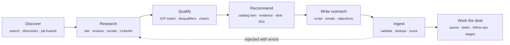

### Data integrity rules

- **Nothing is invented.** Every phone and email carries a source URL. Emails inferred from a pattern are flagged and ranked last.
- Phone numbers are validated against NANP rules and normalized to E.164, with the extension preserved.
- Emails are syntax-checked, junk domains are filtered out, and generic inboxes rank below personal ones.
- Leads that can't be reached, recommend an unknown or inactive service, or lack outreach copy are **rejected with field-level errors**. The agent then fixes them or drops them.
- **Deduplication** by domain, phone and normalized name + city. Re-discovered leads are enriched, and their stage, notes, tasks and manual edits are kept.

### Scoring

The model rates five dimensions from 0 to 10 and must justify each rating with evidence. The server then computes lead quality with the company's weights:

| Dimension | Default weight | Question |
|---|---:|---|
| Fit | 30% | Does the business match the ideal customer profile of the recommended service? |
| Need | 25% | Is there concrete, cited evidence of the pain? |
| Reachability | 20% | Direct line and verified email, ideally of the decision maker? |
| Budget | 15% | Size, locations and industry ticket suggest they can pay |
| Timing | 10% | Recent trigger: hiring, expansion, funding |

On top of that come the niche priority (±3 points per level), a missing phone (−20), no verified email (−5), an identified decision maker (+4) and a direct line (+3).
The tiers are **A ≥ 75** and **B ≥ 55**.

## Project structure

```text
├── .claude/
│   ├── commands/          # /prospectar · /nichos · /preparar-llamada · /nuevo-servicio
│   └── settings.json      # least-privilege tool permissions for the agent
├── config/                # shared, versioned business configuration
├── prompts/               # research playbooks: prospect.md · niches.md · call-prep.md
├── lib/
│   ├── leads.mjs          # validation, normalization, scoring, dedupe, ingest
│   ├── pipeline.mjs       # stages, interest, closeness, suggested tasks, manual edits, migration
│   ├── normalize.mjs      # phones (NANP/E.164), emails, domains, US states & timezones
│   └── store.mjs          # atomic JSON writes, cross-process file lock, backups
├── scripts/
│   ├── cli.mjs            # the agent's only write path: brief · known · ingest · insights · stats · doctor
│   └── demo.mjs           # demo mode with fictional data in .demo-workspace/
├── server/
│   ├── index.mjs          # REST API, SSE, static hosting, git-based updates, startup migration
│   └── runner.mjs         # headless Claude Code runner and stream-json → event translation
├── ui/                    # dependency-free SPA: panel, agenda, queue, kanban, leads, lead drawer, prospecting, niches, catalog
├── tests/                 # node:test suites for the core and the pipeline (incl. v1.0 → v1.1 migration)
├── docs/
│   ├── guia-empleados/    # illustrated team guide (PDF + HTML source)
│   ├── GUIA-DEL-EQUIPO.md # quick reference for the sales team (Spanish)
│   └── screenshots/
├── CHANGELOG.md
└── CLAUDE.md              # project context loaded by Claude Code
```

## Design decisions

| Decision | Rationale |
|---|---|
| **Claude Code instead of the API** | Every rep already has a Claude subscription. Running the agent through `claude -p` removes API keys, usage billing and a hosted backend, and the same playbooks power both the chat and the dashboard. |
| **Prompts as versioned playbooks** | The research method is reviewable, diffable and improvable like code. One improvement to `prompts/prospect.md` raises lead quality for the whole team on the next `git pull`. |
| **Deterministic ingest layer** | LLM output is treated as untrusted input. Validation, normalization, dedupe and scoring live in tested code, and rejections go back to the agent as actionable errors, which creates a self-correcting loop. |
| **Scores computed, not generated** | The model rates dimensions with evidence, and code applies the weights. Lead quality, closeness and niche potential stay consistent across reps, sessions and model versions. |
| **Derived tasks over to-do lists** | Suggested tasks are a function of the lead's state, so they can't go stale and reps don't have to tick off administrative to-dos. |
| **Zero dependencies** | Reps aren't developers. Without `npm install`, there is no supply-chain surface and nothing breaks on a Node upgrade: clone and run. |
| **Local-first data with migrations** | Leads never leave the rep's machine or touch git. Schema changes ship as idempotent, non-destructive migrations with daily backups, so updates are safe to click. |
| **Atomic writes and a file lock** | The server and the agent's CLI write the same database concurrently. A lock based on `mkdir` plus temp-file rename prevents corruption, including on Windows. |
| **Least-privilege agent** | The agent may search, read, write in `workspace/` and run only `node scripts/cli.mjs`. The server binds to `127.0.0.1` and rejects foreign `Host` and `Origin` headers (DNS-rebinding protection). |

## Compliance

- Only **publicly listed business contact data** is collected, and each data point keeps its source.
- Generated emails include an opt-out line (**CAN-SPAM**). *Do not contact* outcomes and the shared blocklist keep opt-outs honored across the team.
- Calls are designed to be placed manually by a rep, with no autodialers or prerecorded messages (**TCPA**).

## Development

```bash
npm test                      # 14 tests: normalization, validation, scoring, dedupe, pipeline, migration
npm run check                 # environment diagnostics
npm run demo                  # UI with fictional data (add -- --reset to regenerate it)
node scripts/cli.mjs help     # all CLI commands
PORT=4700 npm start           # run on another port
```

Append `?quiet=1` to the URL to silence pop-up reminders, for example while screen-sharing in a meeting.

## Roadmap

- [x] Pipeline stages, closeness to a yes, tasks, agenda and reminders (v1.1)
- [x] Calibrated niche potential with cited market data (v1.1)
- [x] Sales guides per service and the AI training service (v1.1)
- [ ] Optional shared lead registry (Supabase or Google Sheets) for cross-rep dedupe beyond territories
- [ ] Manual lead creation for referrals and inbound contacts
- [ ] CRM export (HubSpot / Pipedrive)
- [ ] Email-sending integration with tracked follow-up sequences
- [ ] Win/loss analytics fed back into niche priorities and scoring weights

## License

Copyright © 2026 Devleck. **All rights reserved.** This code is published for portfolio and evaluation purposes. You may view it and run it locally to evaluate it, but you may not copy, modify, distribute or use it commercially without written permission. See [LICENSE](LICENSE), or contact contact@devleck.com for licensing.

---

<div align="center">

Built by **[Devleck](https://www.devleck.com/en)**, a software engineering studio for custom software, process automation and applied AI.

[devleck.com](https://www.devleck.com/en) · [Instagram](https://www.instagram.com/devleck.ia) · contact@devleck.com

</div>
